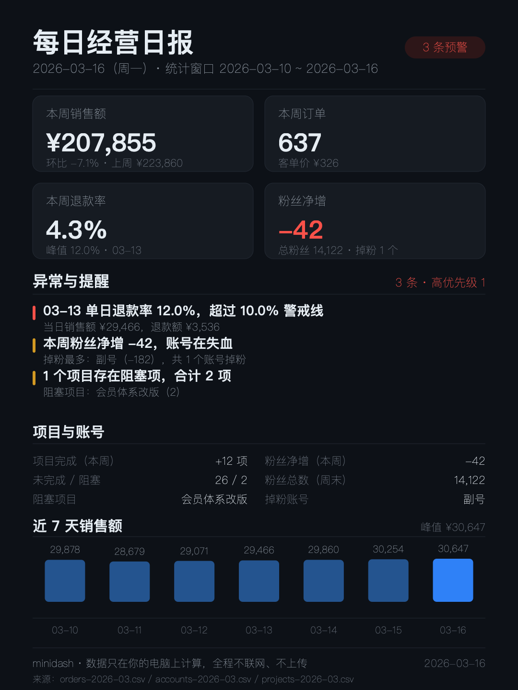

# minidash · 每日经营日报

把导出的三张 CSV（订单 / 账号 / 项目）变成一份当日经营日报：一份给人读的 Markdown，
一张 1080×1440 的深色卡片，可以直接发群、发朋友圈、贴进汇报。

零依赖、一条命令：不用装 npm 包、不用联网、编译服务、不用数据库。所有计算都在你的电脑上完成。

---



## 你会得到什么

1. 一份 `<日期>.md`：一句话结论 + 核心指标 + 异常提醒（每条都写清楚「为什么」）+ 渠道/每日/项目/账号明细。
2. 一张 `<日期>.png`（1080×1440，深色卡片）：手机竖屏能直接看，适合发群，不用再手动做图。
3. 一张 `<日期>.svg`：卡片的源文件，要改颜色、改字号、加 Logo 都在这里改，改完重跑即可。
4. 每天 5 分钟出结果：CSV 一放，命令一跑，日报就齐了；同一天重复跑只覆盖、不堆文件。
5. 出问题会有人替你说话：退款率、销售额环比、粉丝净增、项目阻塞，越线就自动点出来。

---

## 客户三步（不用懂技术）

1. **解压**：把整个 `minidash` 文件夹解压到桌面。
2. **双击 `run.command`**：弹出一个终端窗口，自动跑完，不用敲任何命令。
   （第一次双击若提示「无法验证开发者」：右键点 `run.command` → 打开。）
3. **看 `out/` 里的图**：跑完会自动弹出这个文件夹，里面的 `<日期>.png` 就是能直接发群、发朋友圈的日报卡。

`run.command` 默认读内置的 `data-demo/`（虚构示例数据），所以刚解压就能跑出一份成品；
换成自己的表时：把 CSV 放进本文件夹下的数据目录，然后 `bash run.command 你的数据目录`。

> **Windows**：`.command` 是 macOS 的文件，Windows 上不能双击。Windows 用户在本目录新建 `run.bat`，
> 里面写一行 `node bin\report.mjs --data data-demo --out out`，双击即可（本包不附带该文件，避免双击报错）。

## 单文件版（先看效果，不装任何环境）

```bash
node bin/build-standalone.mjs
```

产出 `dist/minidash.html`：把渲染逻辑与示例数据一起打包进一个文件，**双击就能在浏览器里看到**
一张 1080×1440 日报卡和同一天的文字日报，不联网、不加载任何外部资源、没有 CDN。
它只是「样张」，真实出日报仍然走下面的命令行，产物是 md / svg / png 三个文件。

---

## 三步跑起来

**第 1 步：准备 CSV**

把导出文件放进一个目录，按下面的前缀命名（同一个月可以放多个文件，程序会自动合并）：

```
数据目录/
├── orders-2026-03.csv      # 订单
├── accounts-2026-03.csv    # 账号
└── projects-2026-03.csv    # 项目
```

**第 2 步：跑命令**

```bash
node bin/report.mjs --data data-demo --out out
```

把 `data-demo` 换成你自己的数据目录即可。想指定日期就加 `--day 2026-03-16`。

**第 3 步：打开产物**

```bash
ls out/
# out/2026-03-16.md    人读日报
# out/2026-03-16.png   1080×1440 卡片
# out/2026-03-16.svg   卡片源文件
```

> 环境要求：Node.js 18 或更高版本；生成 PNG 需要本机有 `rsvg-convert`
> （macOS：`brew install librsvg`；Debian/Ubuntu：`apt install librsvg2-bin`）。
> 没有 rsvg-convert 时 md 与 svg 照常生成，命令会提示 PNG 未生成并以非 0 退出。

---

## 字段含义

### orders（订单）

| 字段 | 含义 | 示例 |
| --- | --- | --- |
| date | 日期，支持 `2026-03-16` / `2026/3/16` / `2026年3月16日` / `20260316` | 2026-03-16 |
| channel | 渠道名，自由填 | 淘宝店 |
| orders | 当日订单数 | 92 |
| revenue | 当日销售额（元），可带 ¥ 与千分位 | ¥29,878 |
| refunds | 当日退款金额（元），可带 ¥ 与千分位 | 1,008 |

### accounts（账号）

| 字段 | 含义 | 示例 |
| --- | --- | --- |
| date | 快照日期（每天一行） | 2026-03-16 |
| platform | 平台名 | 微信小店 |
| account | 账号名 | 主店 |
| followers | 当日粉丝总数（累计值，不是新增） | 8,588 |
| interactions | 当日互动量（点赞/评论/私信合计，可选） | 4,190 |

### projects（项目）

| 字段 | 含义 | 示例 |
| --- | --- | --- |
| date | 快照日期（每天一行） | 2026-03-16 |
| project | 项目名 | 会员体系改版 |
| done | 累计已完成任务数（不是当日新增） | 8 |
| open | 当前未完成任务数 | 9 |
| blocked | 当前阻塞任务数 | 2 |

CSV 宽容性：BOM 头、CRLF 换行、字段用引号包裹、字段内含逗号（如 `"¥29,878"`）、
空行、无法识别日期的行（会跳过并在命令行提示行数）都能处理。
缺文件不报错——**缺表不是错误，是版式切换**，规则见下。

### 字段与降级：少给一张表也能出

只给一张表是常态（电商只给订单、内容团队只给账号、项目组只给项目）。程序不会留空框，而是换版式：

| 手上有的表 | 日报卡 KPI（最多 4 格） | 底部图表 | 卡片中部摘要 |
| --- | --- | --- | --- |
| 只有 orders | 本周销售额 / 本周订单 / 本周退款率（第 3 格拉满整行） | 近 7 天销售额 | 不重复展示 |
| 只有 accounts | 粉丝净增 / 粉丝总数 / 本周互动量 / 掉粉账号 | 近 7 天粉丝净增（掉粉日画红色、向下） | 不重复展示 |
| 只有 projects | 项目本周完成 / 未完成项 / 阻塞项 | 各项目当前进度（横条，红色＝有阻塞） | 不重复展示 |
| orders + accounts | 销售额 / 订单 / 退款率 / 粉丝净增 | 近 7 天销售额 | 账号粉丝三行 |
| 三张表都有 | 销售额 / 订单 / 退款率 / 粉丝净增 | 近 7 天销售额 | 项目与账号并排两列 |

两条边界要说清楚：

- 缺了哪张表，仍会在「异常与提醒」里以**提示级**条目点名（例如「没有读到订单表，销售额与退款率这一栏空着」），
  方便排查「是不是文件名前缀写错了」。降级不等于沉默。
- 卡片上不再出现「无数据」字样：缺数据的栏目直接换成能算出来的指标，所以只给一张表的客户拿到手也是一张完整卡片。

---

## 指标怎么算

| 指标 | 算法 |
| --- | --- |
| 统计窗口 | `--day` 当天 + 之前 6 天，共 7 天（默认 `--day` 取 CSV 里的最新日期） |
| 本周销售额 / 订单 / 退款额 | 窗口内求和 |
| 退款率 | 窗口内退款金额 ÷ 销售额 |
| 单日最高退款率 | 窗口内每一天各算一次退款率，取最高那天并点名 |
| 环比 | 本周销售额 ÷ 前 7 天销售额 − 1（前 7 天无数据时不显示环比） |
| 粉丝净增 | 每个账号「窗口末日粉丝数 − 窗口开始前一日粉丝数」，再求和 |
| 掉粉账号 | 上述差额为负的账号 |
| 项目本周完成 | 窗口末日累计完成数 − 窗口开始前一日累计完成数 |
| 阻塞 | 取窗口末日的阻塞任务数，逐项目列出 |

预警规则（默认 5 条，每条都会写一句「为什么」）：

| 规则 | 阈值 |
| --- | --- |
| 本周退款率过高 | > 5% |
| 单日退款率异常 | > 10% |
| 销售额环比大幅下滑 | 跌幅 > 30% |
| 粉丝净增为负 | < 0（净增为正但某账号掉粉时，改报「单账号掉粉」） |
| 存在阻塞项目 | 阻塞数 > 0 |

---

## 怎么改指标

**改阈值**（最常改的一处）：打开 `bin/report.mjs`，文件开头就是阈值集中区：

```js
export const THRESHOLDS = {
  weekRefundRate: 0.05, // 本周退款率警戒线
  dayRefundRate: 0.1,   // 单日退款率警戒线
  revenueDrop: 0.3,     // 销售额环比跌幅警戒线
};
```

改完保存，重跑命令即可，没有编译步骤。

**加一条预警**：在 `detectAnomalies()` 里照着已有规则 `out.push({ ... })` 一条，四段都要写：

```js
out.push({
  id: 'my-rule',                 // 唯一标识
  level: 'high',                 // high（红）/ mid（黄）/ info（蓝）
  title: '标题给结论',            // 卡片第一行
  detail: '数据支撑这句结论',      // 卡片第二行
  why: '为什么这件事值得你今天动手', // 日报里的「为什么」，一句话
});
```

**改指标口径**：`computeMetrics()` 负责算数，返回的对象就是 md 与卡片的数据源；
要加指标就在返回值里加字段，再在 `renderMarkdown()` / `renderSvg()` 里用上。
窗口长度改 `WINDOW_DAYS`（默认 7）。

**改样式**：颜色在 `renderSvg()` 上方的 `C` 对象，字号与纵向排版就在 `renderSvg()` 里，
卡片尺寸改 `CARD`（默认 1080×1440）。

---

## 数据不出本机

- 本工具**不发起任何网络请求**，代码里没有 http/fetch/axios，也不读环境变量里的密钥。
- 只读取 `--data` 指定目录下的 `orders-*.csv` / `accounts-*.csv` / `projects-*.csv`，只写入 `--out` 指定目录。
- 不调用任何云端服务；PNG 由本机的 `rsvg-convert` 在本地渲染。
- PNG 生成后会做一次**无损重压缩**（只换压缩级别，inflate 出来的像素数据一个字节都不动）：
  压缩流里偶尔会凑出三字节 ASCII 序列，粗颗粒的敏感词扫描会把它当命中，这一步顺手绕开。
- 想复核：`grep -nE "fetch\(|axios|node:https|node:net" bin/report.mjs` 没有任何命中。
  `http` 三个字母只出现在 SVG 的 `xmlns="http://www.w3.org/2000/svg"` 里——那是 XML 命名空间的固定标识，
  不是网址、不会发起请求。
- 也可以直接断网跑一遍，产物与联网时完全一样。

---

## 目录结构

```
minidash/
├── run.command              # 一键跑（macOS 双击）：查 node → 跑日报 → 打开 out/
├── bin/report.mjs           # CLI 入口：读 CSV → 算指标 → 出 md / svg / png
├── bin/build-standalone.mjs # 打包单文件版 dist/minidash.html（双击看样张）
├── data-demo/               # 虚构示例数据（15 天，故意埋了 12% 退款日、掉粉账号、阻塞项目）
│   ├── orders-2026-03.csv
│   ├── accounts-2026-03.csv
│   └── projects-2026-03.csv
├── dist/minidash.html       # 单文件样张（build-standalone.mjs 的产物）
├── tests/                   # node --test，32 条
└── README.md
```

## 跑测试

```bash
node --test
```

覆盖：CSV 边界（BOM / CRLF / 引号 / 千分位）、指标算式、五条预警规则的触发与不触发、
缺文件降级、PNG 尺寸（IHDR = 1080×1440）、同一天重复跑的幂等性与覆盖，
以及单表降级时的 KPI 数量/标题（只有订单、只有账号、两种都有）与「渲染结果里不出现无数据字样」。

---

## Need this on your own data?

This repo is the tool. If you want the same daily report running on **your** exports,
I do the setup end to end — you send a CSV, you get a dashboard and a daily report card.

| What | Scope | Price |
| --- | --- | --- |
| E-commerce daily report | 1 store, orders export (date, channel, orders, revenue, refunds) | 6,800 CNY / ~1,017 USDC |
| Content matrix report | 3 accounts, followers + interactions export | 9,800 CNY / ~1,466 USDC |
| Project board report | one repo or task sheet (done / open / blocked) | 4,800 CNY / ~718 USDC |
| Custom small automation | script, scraper or report, per day | 300–800 CNY / 45–120 USDC per day |

- Delivery: 3–5 days. Runs on your machine; nothing is uploaded.
- Payment: CNY or USDT/BTC. 50% upfront, 50% on acceptance.
- Not included: anything behind a login (no scraping with your credentials), no mobile app, no revenue promises.

**Contact: open an issue on this repo** with the word `setup` and what you export. I reply within a day.

