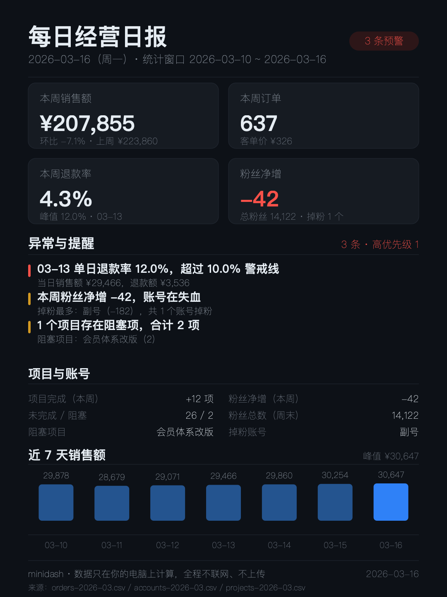

# Before / After

A real before-and-after from the bundled demo data. No mockups, everything below is produced by `node bin/report.mjs`.

## Before: what you have

One CSV export from your admin panel (`data-demo/orders-2026-03.csv`, abridged):

```csv
date,channel,orders,revenue,refunds
2026-03-13,淘宝店,32,"¥10,400","¥2,106"
2026-03-13,微信小店,18,"¥6,120","¥1,224"
2026-03-14,淘宝店,33,"¥10,700","¥520"
```

That is the whole input. No account, no API key, no database.

## After: what you get (one command, ~0.4s)

```sh
node bin/report.mjs --data data-demo --out out
```

Three files appear in `out/`:

```
out/2026-03-16.md     ← text report you can paste into WeChat / Slack
out/2026-03-16.svg    ← the card, editable
out/2026-03-16.png    ← the card, 1080x1440, ready to post
```

### The text report says this

> **本周销售额 ¥207,855（环比 -7.1%）；订单 637 单；退款率 4.3%；粉丝净增 -42；1 个项目阻塞。**
>
> 1. **[高] 03-13 单日退款率 12.0%，超过 10.0% 警戒线**
>    当日销售额 ¥29,466，退款额 ¥3,536
>    为什么：单日尖峰往往对应一次集中退货或一场活动翻车，当天就该找渠道当面复盘。
> 2. **[中] 本周粉丝净增 -42，账号在失血**
>    掉粉最多：副号（-182），共 1 个账号掉粉
> 3. **[中] 1 个项目存在阻塞项，合计 2 项**

### The card looks like this



## What the numbers actually mean

| Number | How it is computed |
| --- | --- |
| 本周销售额 | sum of `revenue` for the last 7 days present in the file |
| 环比 | this week ÷ previous 7 days − 1 (needs 14 days of data) |
| 退款率 | sum(`refunds`) ÷ sum(`revenue`) in the window |
| 单日最高退款率 | max over days of `refunds ÷ revenue` |
| 粉丝净增 | last day of window − the day before the window, per account, then summed |
| 异常规则 | refund rate > 5% (weekly) or > 10% (single day), sales drop > 30% week over week, negative follower growth, any blocked project |

All definitions are printed at the bottom of the markdown report, so a client can audit them.

## Why this beats a spreadsheet

You can build the same numbers in a spreadsheet once. The difference is that you have to do it again tomorrow.
This runs in 0.4 seconds on a cron-like schedule and the output is a decision, not a table.

